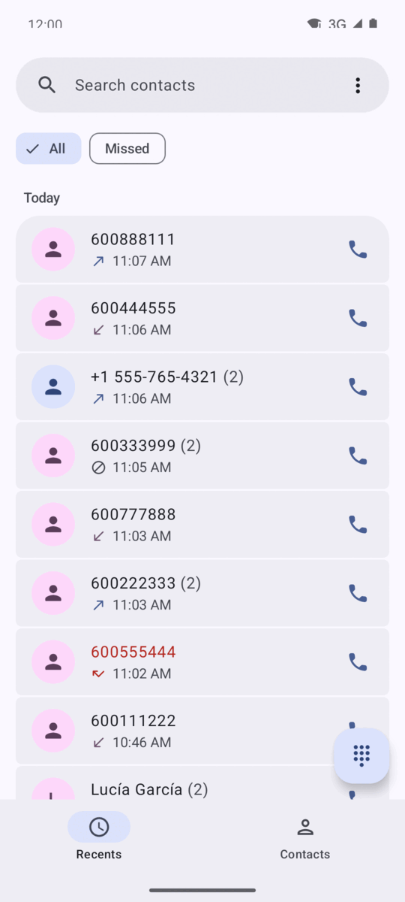
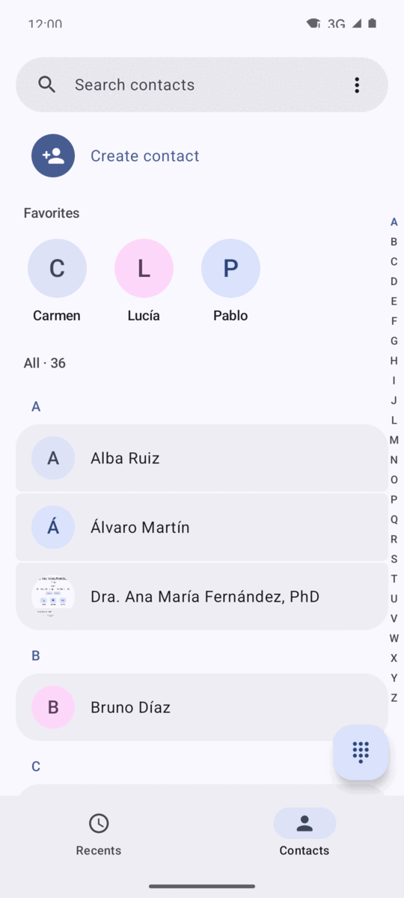
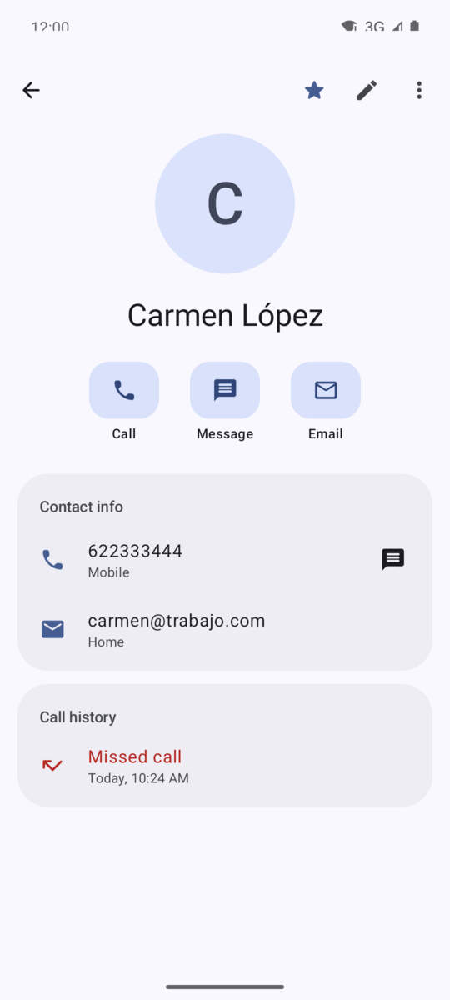
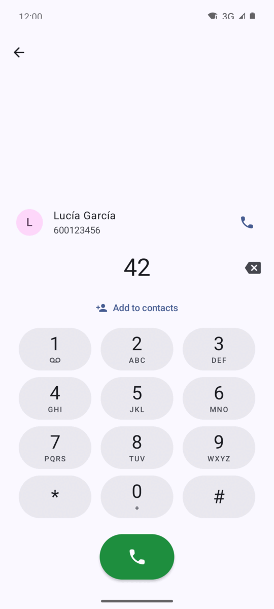
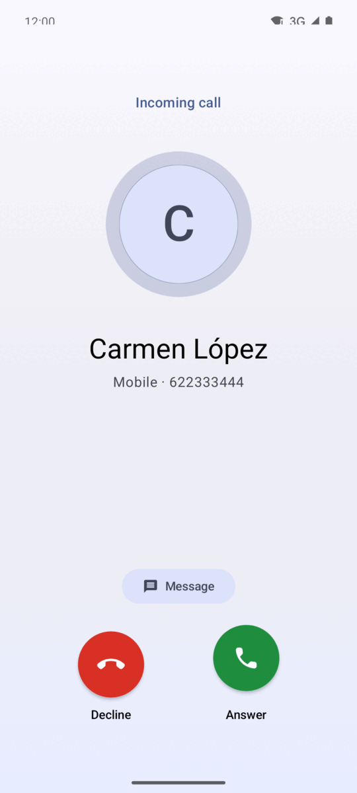
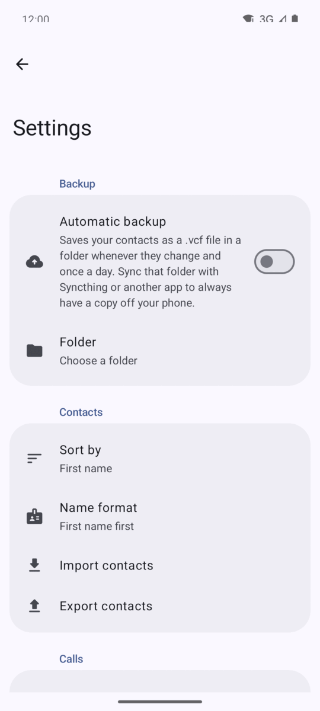

# Phone

A contacts and dialer app for Android, built with Kotlin and Jetpack Compose (Material 3 / Material You).

It replaces both the system Contacts and Phone apps: it can be set as the default dialer and handles calls end to end. It has **no internet permission**: your contacts and call history never leave the device, except for the backups you choose to write to a folder.

<p align="center">
  
  
  
</p>
<p align="center">
  
  
  
</p>

## Features

### Calls
- Default dialer (`ROLE_DIALER`) with its own `InCallService`.
- Full-screen incoming call over the lock screen, and an ongoing call notification (CallStyle) with a timer.
- Mute, keypad (DTMF), speaker / Bluetooth / earpiece, hold, proximity sensor.
- Call waiting: hold and answer, end and answer, add call, swap, and merge into a conference.
- SIM selection on dual-SIM phones.
- Decline with a quick text reply.
- Missed call notification with call back and message actions.
- Long-press 1 to call voicemail.

### Keypad and Recents
- T9 search: type `4-2` to find "**Ga**rcía", or part of a number.
- Recents grouped by day, with an All / Missed filter.
- Details screen for numbers that aren't contacts: call, message, add, copy, block, delete history.
- Block and unblock numbers using the system blocked-numbers list.

### Contacts
- Every standard Android contact field: structured name and phonetic name, nickname, organization, phones, emails, postal addresses, IM, websites, SIP, events (birthday with or without year, anniversary…), relations, notes and labels (groups), all with custom labels.
- Photo, favorite, custom ringtone and send-to-voicemail per contact.
- Choose the account when creating a contact (device, Google…).
- Favorites row, fast scroller, and sort/display by first or last name.
- vCard 3.0 import, export and sharing. Android-specific fields are kept as vCard extensions, so an export → import round trip loses nothing.

### Automatic backup
Pick a folder, for example one synced with [Syncthing](https://syncthing.net/), and the app writes all your contacts to it as a `.vcf` file:

- about 30 seconds after any contact changes, and once a day;
- one file per day (`contacts-2026-11-08.vcf`), keeping the newest 1, 7, 30 or all of them;
- nothing is written if the contacts didn't change, and an empty contact list never overwrites a backup;
- files are written to a temporary name and renamed when complete, so a sync app never picks up a half-written file.

To restore, use **Settings → Import contacts** and pick the newest file.

### Settings
- Theme: system, light or dark, plus wallpaper (dynamic) colors on Android 12+.
- Keypad tones and vibration.
- English and Spanish, with per-app language selection on Android 13+.

## Requirements

- Android 8.0 (API 26) or later. Targets API 34.
- To build: JDK 17 and the Android SDK.

## Building

```bash
./gradlew assembleDebug        # app/build/outputs/apk/debug/app-debug.apk
./gradlew assembleRelease      # minified with R8
```

Install on a connected device:

```bash
./gradlew installDebug
```

> The `release` build type is signed with the local debug key so it can be installed directly. Before distributing it, set up your own signing key in `app/build.gradle.kts`.

After installing, open the app, grant the permissions and accept the prompt to make it the default phone app.

## Tech stack

- Kotlin, Jetpack Compose, Material 3, Navigation Compose
- Android Telecom (`InCallService`, `TelecomManager`), `ContactsContract`, `CallLog`, `BlockedNumberContract`
- WorkManager for the automatic backup, Storage Access Framework for the backup folder
- [ez-vcard](https://github.com/mangstadt/ez-vcard) for vCard parsing and writing
- [Coil](https://coil-kt.github.io/coil/) for contact photos

## Project structure

```
app/src/main/java/dev/hostyn/phone/
├── call/        InCallService, call state, in-call UI and notifications
├── data/        Contacts, call log, blocking, settings, vCard and backup
└── ui/          Compose screens: home, recents, contacts, detail, edit,
                 dialer, number details, blocked numbers, settings
```
